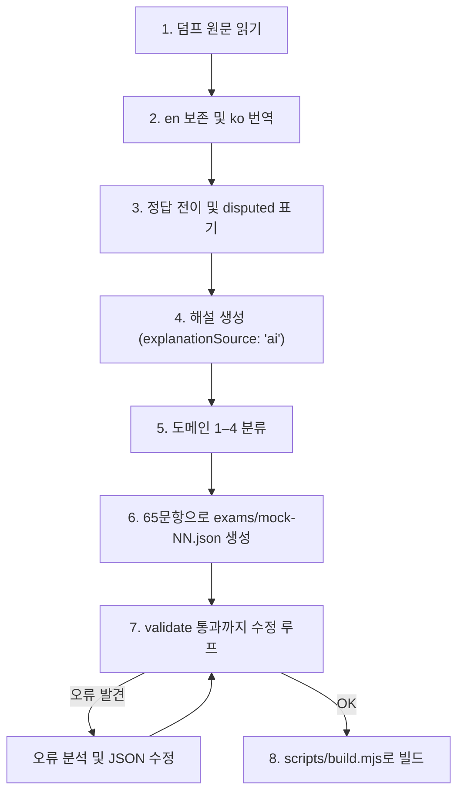

# AWS SAA 덤프 변환 스킬 (dump-to-exam)

이 문서는 AWS Certified Solutions Architect - Associate (SAA-C03) 시험 덤프 자료를 본 프로젝트의 모의고사 데이터(`exams/mock-NN.json`)로 변환하고 검증·빌드(`dist/mock-NN.html`)하는 표준 작업 절차를 정의한다.

## 1. 개요 및 설계 원칙

1. **단일 HTML 결과물**: 빌드 결과물은 네트워크 요청 없는 독립 실행형 단일 HTML 파일이어야 한다.
2. **이중 언어 병기(ko/en)**: 모든 텍스트(문제 지문, 보기, 라벨, 해설)는 한국어(`ko`)와 영어(`en`)를 모두 제공한다.
3. **엄격한 스키마 준수**: `scripts/validate.mjs`의 유효성 검사를 통과하지 못하면 빌드할 수 없다.
4. **결정론적 채점**: 문항 단위로 모든 정답을 맞혀야 정답으로 처리되며 부분 점수는 없다.
5. **데모 전용 필드 배제**: 데모 픽셀 재현용 힌트 필드(`compact`)는 덤프 변환 시 절대 사용하지 않는다.

---

## 2. 덤프 변환 8단계 절차 (스펙 7절)

스펙 7절에 정의된 8단계를 순서대로 엄격히 수행한다.



### 1단계: 덤프 원문을 읽는다
- 덤프 원본 텍스트, 마크다운, PDF 또는 스크랩 자료에서 문항 번호, 지문(stem), 보기/선택지(options/choices), 원문 정답, 원문 해설을 파싱한다.
- 문항의 성격에 따라 5가지 유형(`single`, `multiple`, `ordering`, `matching`, `caseStudy`) 중 하나로 식별한다.

### 2단계: 원문 언어를 en에 보존하고 ko로 번역한다
- 원본 영어 텍스트를 `en` 필드에 보존한다.
- 시험 화면에 기본 표시될 한국어 번역을 작성하여 `ko` 필드에 입력한다. 번역은 AWS 공식 한국어 문서 용어(예: EC2, Auto Scaling, 서브넷, 가용 영역 등)를 준수하며 자연스럽고 명확해야 한다.
- 모든 지문과 보기는 `{ "ko": "...", "en": "..." }` 형태의 객체여야 하며 빈 문자열(`""`)은 허용되지 않는다.
- 지문 내 문단 구분은 `\n\n`을 사용한다. 본문은 일반 텍스트로 렌더링되므로 HTML 태그(`<b>`, `<br>` 등)를 넣지 않는다.

### 3단계: 정답을 옮긴다. 원문 정답이 의심스러우면 `disputed`로 표시한다
- 덤프의 정답을 유형별 규격에 맞게 변환한다:
  - `single`: `["B"]` (정확히 1개 원소의 문자열 배열)
  - `multiple`: `["A", "C"]` (`select` 숫자와 동일한 길이의 배열)
  - `ordering`: 슬롯 순서대로 choice id를 나열한 배열
  - `matching`: `{ promptId: choiceId }` 형태의 키-값 맵 객체
- 덤프 원문의 정답이 AWS 권장 아키텍처나 모범 사례와 상충하거나, 커뮤니티 투표에서 정답 논란이 있는 경우 `disputed: true`를 지정한다. (UI에서 `정답 논란` 배지 노출)

### 4단계: 해설을 생성하고 `explanationSource: "ai"`로 표시한다
- 정답의 이유뿐만 아니라 다른 보기가 오답인 이유를 명확하게 설명하는 해설을 한국어와 영어로 작성한다.
- 덤프 원본에 포함된 해설을 그대로 옮긴 경우: `"explanationSource": "dump"`
- AI가 새로 작성하거나 보강한 경우: `"explanationSource": "ai"` (UI에서 `AI 해설` 배지 노출)

### 5단계: 도메인 1–4로 분류한다
AWS SAA-C03 시험의 4대 평가 영역 기준에 따라 각 문항의 `domain`을 1~4 정수로 분류한다:
- `1`: 업무 탄력성 있는 아키텍처 설계 (Design Resilient Architectures) — 시험 비중 ~30%
- `2`: 고성능 아키텍처 설계 (Design High-Performing Architectures) — 시험 비중 ~28%
- `3`: 안전한 애플리케이션 및 아키텍처 설계 (Design Secure Applications and Architectures) — 시험 비중 ~24%
- `4`: 비용 최적화 아키텍처 설계 (Design Cost-Optimized Architectures) — 시험 비중 ~18%

### 6단계: 65문항으로 `exams/mock-NN.json`을 만든다
- 1회차 모의고사는 실제 시험과 동일하게 **총 65문항**으로 구성한다.
- 파일명 규칙: `exams/mock-01.json`, `exams/mock-02.json` 등 (소문자, 숫자, 하이픈)
- 기본 메타데이터:
  ```json
  {
    "id": "mock-01",
    "title": "AWS Certified Solutions Architect - Associate",
    "candidate": "수험자",
    "durationMinutes": 130,
    "items": [ ... ]
  }
  ```
- 주의: 같은 `caseStudy` 값을 가진 문항들은 서로 연속해서 배치해야 한다.

### 7단계: `validate` 통과까지 고친다 (수정 루프)
JSON 파일 생성이 완료되면 `scripts/validate.mjs` 검증기를 통과할 때까지 피드백 루프를 반복한다.

#### 유효성 검사 실행
```bash
node scripts/validate.mjs exams/mock-01.json
```

#### 수정 루프 절차
1. **오류 출력 확인**: 검증 실패 시 출력되는 경로와 상세 오류 메시지를 확인한다.
   - 예: `items[12].answer: 길이가 select(2)와 같아야 한다`
   - 예: `items[25].caseStudy: 'cs1' 문항이 연속되지 않는다`
   - 예: `items[40].stem.ko: 비어 있지 않은 문자열이어야 한다`
2. **원인 분석 및 파일 수정**:
   - JSON 구문 오류: 쉼표 누락, 따옴표 이스케이프 등 수정.
   - 문항 ID 중복: 각 문항의 `id`가 시험 전체에서 고유한지 확인하고 수정.
   - 다중 선택 불일치: `select` 값과 `answer` 배열 원소 개수를 일치시킴.
   - 보기 ID 오류: `options`의 `id`는 `/^[A-F]$/` 범위여야 하며, `answer`의 모든 값이 `options`의 id에 존재해야 함.
   - 순서형/매칭형 오류: 슬롯/프롬프트 개수와 정답 매핑 누락 여부 확인.
   - 언어 누락: `ko`, `en` 필드가 비어 있지 않은 문자열인지 확인.
   - 도메인 범위: `domain`이 1, 2, 3, 4 중 하나인지 확인.
   - 사례 연구(caseStudy) 불연속: 동일한 `caseStudy` 식별자를 가진 문항들이 연속 배치되었는지 확인.
3. **재검증 실행**: 수정한 파일을 저장하고 다시 `node scripts/validate.mjs exams/mock-01.json`을 실행한다.
4. **반복**: 오류 메시지 수가 0개가 되고 콘솔에 `exams/mock-01.json: OK`가 출력될 때까지 1~3 과정을 반복한다.

### 8단계: `build`한다
검증을 통과한 JSON 파일을 번들러로 빌드하여 단일 HTML 파일로 변환한다.
```bash
node scripts/build.mjs exams/mock-01.json
# 또는
npm run build -- exams/mock-01.json
```
- `dist/mock-01.html` 파일이 생성되었는지 확인한다.
- 브라우저(`file://` 경로)로 열어 초기 화면, 문항 화면(타이머, 플래그, 언어 토글), 검토 화면, 채점 결과 화면이 정상 작동하는지 확인한다.

---

## 3. 문항 유형별 JSON 작성 명세

### 3.1 단일 선택형 (`single`)
```json
{
  "id": "q1",
  "type": "single",
  "domain": 1,
  "stem": {
    "ko": "한 회사가 단일 가용 영역의 Amazon EC2 인스턴스에서 웹 애플리케이션을 호스팅하고 있습니다...",
    "en": "A company is hosting a web application on an Amazon EC2 instance in a single Availability Zone..."
  },
  "options": [
    { "id": "A", "ko": "애플리케이션을 AWS Elastic Beanstalk 다중 AZ 환경으로 마이그레이션합니다.", "en": "Migrate the application to an AWS Elastic Beanstalk Multi-AZ environment." },
    { "id": "B", "ko": "Auto Scaling 그룹과 Application Load Balancer를 구성합니다.", "en": "Configure an Auto Scaling group with an Application Load Balancer." },
    { "id": "C", "ko": "인스턴스 크기를 늘립니다.", "en": "Increase the instance size." },
    { "id": "D", "ko": "Amazon Route 53 장애 조치 라우팅 정책을 설정합니다.", "en": "Set up an Amazon Route 53 failover routing policy." }
  ],
  "answer": ["B"],
  "explanation": {
    "ko": "고가용성과 탄력성을 확보하기 위해서는 ALB와 다중 AZ에 걸친 Auto Scaling 그룹을 구성해야 합니다.",
    "en": "To achieve high availability and elasticity, configure an ALB with an Auto Scaling group spanning multiple AZs."
  },
  "explanationSource": "ai"
}
```

### 3.2 다중 선택형 (`multiple`)
```json
{
  "id": "q2",
  "type": "multiple",
  "domain": 3,
  "select": 2,
  "stem": {
    "ko": "보안 요구 사항을 충족하기 위해 Amazon S3 버킷에 저장된 데이터를 보호해야 합니다. 두 가지를 선택하십시오.",
    "en": "A company must protect data stored in an Amazon S3 bucket to meet security requirements. (Select TWO.)"
  },
  "options": [
    { "id": "A", "ko": "AWS KMS 키(SSE-KMS)를 사용한 서버 측 암호화를 활성화합니다.", "en": "Enable server-side encryption with AWS KMS keys (SSE-KMS)." },
    { "id": "B", "ko": "모든 객체를 공개 읽기 가능으로 설정합니다.", "en": "Set all objects to public read." },
    { "id": "C", "ko": "S3 버킷 정책에서 aws:SecureTransport 조건을 적용합니다.", "en": "Enforce aws:SecureTransport condition in S3 bucket policy." },
    { "id": "D", "ko": "버킷의 버전 관리를 비활성화합니다.", "en": "Disable versioning on the bucket." }
  ],
  "answer": ["A", "C"],
  "disputed": false,
  "explanation": {
    "ko": "SSE-KMS를 통한 저장 데이터 암호화와 aws:SecureTransport를 통한 전송 중 TLS 암호화 강제가 보안 모범 사례입니다.",
    "en": "Server-side encryption via SSE-KMS and enforcing TLS in transit using aws:SecureTransport are security best practices."
  },
  "explanationSource": "ai"
}
```

### 3.3 순서 배치형 (`ordering`)
```json
{
  "id": "q3",
  "type": "ordering",
  "domain": 1,
  "stem": {
    "ko": "다음 절차를 올바른 순서로 정렬하십시오.",
    "en": "Order the steps in the correct sequence."
  },
  "choices": [
    { "id": "c1", "ko": "VPC 및 서브넷 생성", "en": "Create VPC and subnets" },
    { "id": "c2", "ko": "인터넷 게이트웨이 연결", "en": "Attach Internet Gateway" },
    { "id": "c3", "ko": "라우팅 테이블 경로 구성", "en": "Configure route table routes" }
  ],
  "slots": [
    { "label": { "ko": "1단계", "en": "Step 1" }, "side": "left" },
    { "label": { "ko": "2단계", "en": "Step 2" }, "side": "left" },
    { "label": { "ko": "3단계", "en": "Step 3" }, "side": "left" }
  ],
  "answer": ["c1", "c2", "c3"],
  "explanation": {
    "ko": "VPC를 먼저 생성한 후 인터넷 게이트웨이를 연결하고 라우팅을 추가해야 합니다.",
    "en": "Create the VPC first, then attach the IGW, and finally configure the routing table."
  },
  "explanationSource": "ai"
}
```

### 3.4 매칭/범주 연결형 (`matching`)
```json
{
  "id": "q4",
  "type": "matching",
  "domain": 2,
  "stem": {
    "ko": "각 스토리지 요구 사항에 적합한 AWS 서비스를 선택하십시오.",
    "en": "Select the appropriate AWS service for each storage requirement."
  },
  "choices": [
    { "id": "c1", "ko": "Amazon S3", "en": "Amazon S3" },
    { "id": "c2", "ko": "Amazon EFS", "en": "Amazon EFS" },
    { "id": "c3", "ko": "Amazon EBS", "en": "Amazon EBS" }
  ],
  "prompts": [
    { "id": "p1", "ko": "단일 인스턴스 전용 고성능 블록 스토리지", "en": "Dedicated high-performance block storage for a single instance" },
    { "id": "p2", "ko": "다중 Linux 인스턴스 공유 POSIX 파일 시스템", "en": "POSIX file system shared across multiple Linux instances" }
  ],
  "answer": {
    "p1": "c3",
    "p2": "c2"
  },
  "explanation": {
    "ko": "단일 인스턴스 블록 스토리지는 EBS, 다중 인스턴스 공유 파일 시스템은 EFS가 적합합니다.",
    "en": "EBS provides block storage for a single instance; EFS provides shared POSIX file storage for multiple instances."
  },
  "explanationSource": "ai"
}
```

### 3.5 사례 연구 (`caseStudy`)
```json
{
  "caseStudies": {
    "cs1": {
      "scenario": {
        "ko": "글로벌 전자상거래 기업 시나리오: 회사는 전 세계 고객을 대상으로...",
        "en": "Global E-Commerce Company Scenario: The company serves customers worldwide..."
      }
    }
  },
  "items": [
    {
      "id": "cs1-q1",
      "caseStudy": "cs1",
      "type": "single",
      "domain": 1,
      "stem": { "ko": "시나리오에 설명된 데이터베이스 요구 사항을 충족하는 아키텍처는?", "en": "Which architecture meets the database requirements described in the scenario?" },
      "options": [ ... ],
      "answer": ["A"],
      "explanation": { "ko": "...", "en": "..." },
      "explanationSource": "ai"
    },
    {
      "id": "cs1-q2",
      "caseStudy": "cs1",
      "type": "multiple",
      "domain": 2,
      "select": 2,
      "stem": { "ko": "시나리오에서 성능을 최적화하기 위한 방안 2가지는?", "en": "Which two approaches optimize performance in the scenario?" },
      "options": [ ... ],
      "answer": ["B", "D"],
      "explanation": { "ko": "...", "en": "..." },
      "explanationSource": "ai"
    }
  ]
}
```

---

## 4. 체크리스트

덤프 변환을 완료하고 PR/커밋하기 전에 다음 항목을 점검한다:

- [ ] 총 문항 수가 65문항인가?
- [ ] 모든 문항에 유효한 `domain`(1~4)이 지정되어 있는가?
- [ ] 모든 지문, 옵션, 라벨, 해설에 비어 있지 않은 `ko`와 `en`이 존재하는가?
- [ ] `options`의 id가 `A`~`F`이며 중복되지 않는가?
- [ ] `multiple` 문항의 `select` 값과 `answer`의 원소 개수가 일치하는가?
- [ ] 정답에 논란이 있는 경우 `disputed: true`가 설정되었는가?
- [ ] `explanationSource`가 `"ai"` 또는 `"dump"`로 올바르게 지정되었는가?
- [ ] `caseStudy` 문항들이 연속해서 배치되어 있는가?
- [ ] 데모 전용 힌트인 `compact` 필드가 포함되지 않았는가?
- [ ] `node scripts/validate.mjs exams/mock-NN.json`을 실행하여 오류 없이 `OK`가 출력되는가?
- [ ] `node scripts/build.mjs exams/mock-NN.json`을 실행하여 `dist/mock-NN.html`이 정상 생성되는가?
